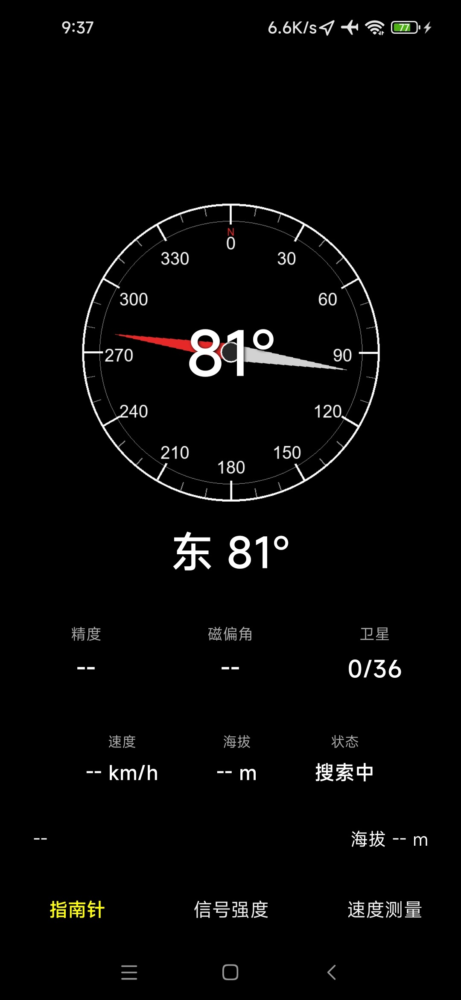
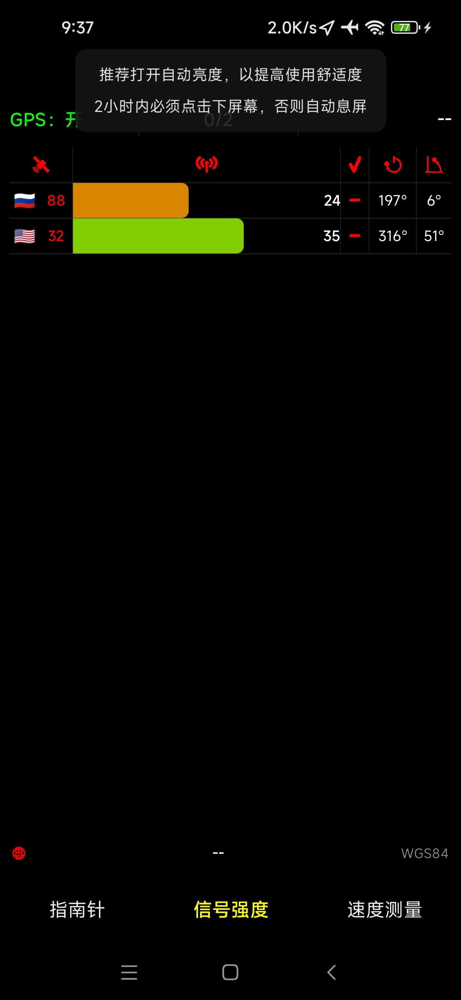
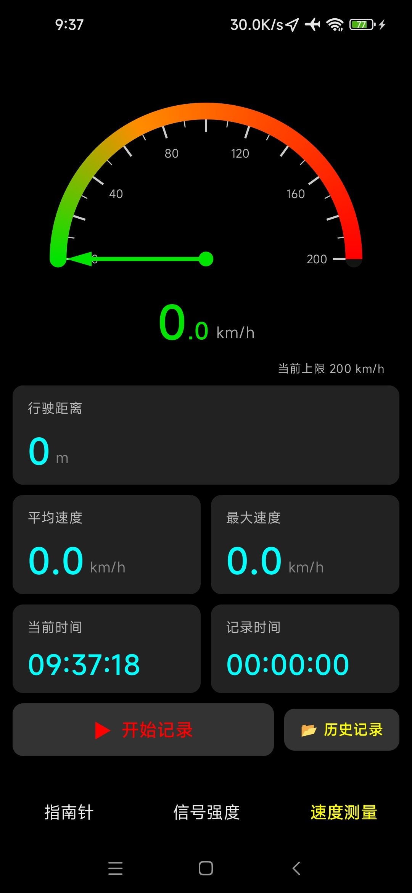
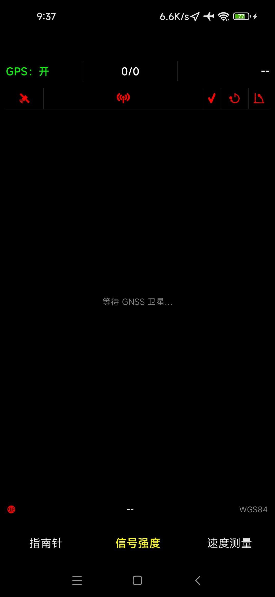

# GPS 工具箱

Android GPS/GNSS 测试工具，包名 `com.gpstesttools`。用于查看定位状态、卫星分布、指南针方位，并记录行驶速度/轨迹数据。

## 功能

- 定位信息：经纬度、速度、精度、海拔、定位状态（GNSS 原生回调）
- 星空图：卫星方位/高度角/信噪比，按星座着色
- 指南针：ROTATION_VECTOR 融合方位角 + 磁偏角修正
- 行驶记录：CSV 落盘（应用私有外部目录），支持暂停/继续与历史列表
- 速度图表：原始数据 EMA 平滑后分桶统计，支持缩放
- 记录备份/还原：打包 zip 到存储根目录，跨设备迁移
- 后台保活：定位前台服务 + 唤醒锁，防 ROM 冻结 GPS

## 界面截图

<p align="center">
  
  
  
  
</p>

## 环境要求

| 项目 | 版本 |
| --- | --- |
| JDK | 25（Gradle daemon 工具链） |
| Android SDK | compileSdk / targetSdk 37 |
| minSdk | 28（Android 9） |

## 本地构建

```bash
# Debug
./gradlew :app:assembleDebug

# Release（自动使用 signing/ 下的签名）
./gradlew :app:assembleRelease

# 指定版本号（默认 1 / 1.0）
./gradlew :app:assembleRelease -Pgps.versionCode=10203 -Pgps.versionName=1.2.3
```

## 签名

发布签名为随机生成的密钥。

## 自动发布

`.github/workflows/release.yml` 在以下时机构建并签名 Release APK：

1. 推送 `v*` tag（如 `v1.2.3`）：自动创建 GitHub Release 并上传产物
2. 在 GitHub 页面发布（Publish）Release：构建后把产物补传到该 Release
3. 手动触发（Actions → Release → Run workflow）

产物包含：

- `GPS-Toolbox-<version>.apk`
- `GPS-Toolbox-<version>.apk.sha256`

版本号映射：`v<major>.<minor>.<patch>` → `versionName=<major>.<minor>.<patch>`，`versionCode=major*10000+minor*100+patch`（如 `v1.2.3` → `10203`）。非语义化 tag 或手动触发时，`versionCode` 使用 Actions 运行序号。

发布示例：

```bash
git tag v1.0.0
git push origin v1.0.0
```

## 目录结构

```
app/src/main/java/com/gpstesttools/
├── MainActivity.kt              # 入口、权限、页面切换、引擎启停
├── LocationKeepAliveService.kt  # 定位前台服务
├── gps/                         # GNSS、指南针、记录存储、备份、图表缓存
└── ui/                          # Compose 页面、组件与主题
signing/                         # 本地发布签名（不入库）
docs/screenshots/                # README 界面截图
.github/workflows/release.yml    # 自动打包与发布
```
